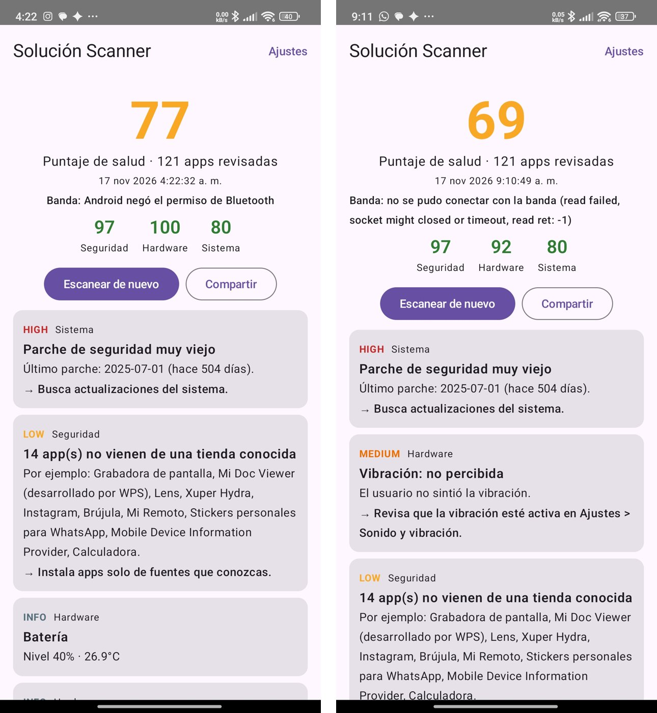

# Solución Scanner: documentación técnica de la app

> Versión 0.3.0-early-access (17-nov-2026). Es la misma explicación del capítulo 7 del informe técnico final.

### 7.1 Qué hace
*Solución Scanner* es la app Android del proyecto. Revisa el celular en cuatro etapas (hardware, pruebas activas de hardware, sistema y aplicaciones), suma las pruebas manuales que el usuario haya hecho y entrega un puntaje de salud de 0 a 100 con la lista de hallazgos y qué hacer con cada uno (Equipo Proyecto Solución, 2026d). Al terminar, manda a la banda la letra `A` o `R` por Bluetooth. El código está en el repositorio del proyecto: https://github.com/Monocucuy/Proyecto-Solucion (Equipo Proyecto Solución, 2026e).

**Tecnologías de la app**

| Parte | Tecnología | Para qué |
|---|---|---|
| Lenguaje e interfaz | Kotlin + Jetpack Compose (Material 3) | Pantallas declarativas, sin XML de diseño |
| Versiones de Android | `minSdk` 26 (Android 8.0), `targetSdk` 35 | Funciona desde Android 8 en adelante |
| Datos locales | Room (caché de hashes) y almacenamiento cifrado | Guardar resultados y ajustes en el celular |
| Red | Retrofit + OkHttp + kotlinx.serialization | Consultar el servicio de reputación (opcional) |
| Bluetooth | `BluetoothSocket` RFCOMM con el perfil SPP | Mandar `A` o `R` al ESP32 |
| Compilación | Gradle + GitHub Actions | Pruebas y APK en la nube (no hay Android Studio en el PC) |
*Nota.* Tomado de `app/build.gradle.kts` y del código fuente de la rama `bluetooth-banda`.
### 7.2 Cómo está organizado el código
La app sigue una arquitectura sencilla: una sola actividad (`MainActivity`) que muestra pantallas de Compose, un `ScanViewModel` que dirige el escaneo y módulos que revisan cada parte del celular (la tabla).

**Módulos principales del código**

| Archivo | Qué hace |
|---|---|
| `ui/Portada.kt` | Portada animada al abrir la app (versión 0.3.0) |
| `ui/Screens.kt` | Inicio, progreso, reporte, error y ajustes; flechas de volver |
| `ui/ManualTests.kt` | Seis pruebas manuales: pantalla, táctil, altavoz, vibración, micrófono y cámara |
| `ui/ScanViewModel.kt` | Ejecuta las etapas, arma el reporte, guarda el log y llama a la banda |
| `scan/HardwareChecker.kt` | Batería, temperatura, almacenamiento, RAM y estado térmico |
| `scan/HardwareTests.kt` | Pruebas activas: sensores que responden, cámaras, linterna y componentes |
| `scan/SystemChecker.kt` | Versión de Android, parche de seguridad, bloqueo de pantalla y depuración USB |
| `scan/AppScanner.kt` | Apps instaladas: origen (tienda), permisos y reputación por hash |
| `domain/Models.kt` | Severidades, categorías y cálculo del puntaje |
| `bt/BandaBluetooth.kt` | Conexión SPP con `BANDA-ESP32` y decisión `A`/`R` |
| `debug/DebugLog.kt` | Registro de depuración en un archivo (máximo 200 kB) |
### 7.3 Cómo se calcula el puntaje
Cada hallazgo tiene una severidad que resta puntos: INFO resta 0, LOW resta 3, MEDIUM resta 8 y HIGH resta 20 (la tabla). Cada categoría (Seguridad, Hardware y Sistema) empieza en 100 y se le restan sus hallazgos; el puntaje total también empieza en 100 y se le restan **todos** los hallazgos. Por eso el total no es el promedio de las tres categorías.

**Penalización por severidad**

| Severidad | Resta | Ejemplos |
|---|---|---|
| HIGH | 20 | Parche de seguridad de más de un año, sin bloqueo de pantalla, Android desactualizado, app con malware, batería a 45 °C o más |
| MEDIUM | 8 | Vibración no percibida, parche de más de 6 meses, poco almacenamiento, sensor sin respuesta, permisos peligrosos combinados |
| LOW | 3 | Apps que no vienen de una tienda conocida (se resta una sola vez), depuración USB activa, sin acelerómetro |
| INFO | 0 | Datos del equipo: batería, RAM, sensores, cámaras |
*Nota.* Valores de `domain/Models.kt` y de los módulos de `scan/`.
La la figura muestra dos escaneos reales del mismo celular el 17 de noviembre de 2026. En el de las 4:22 a. m. hubo un hallazgo HIGH en Sistema (parche de seguridad de hace 504 días, −20) y uno LOW en Seguridad (14 apps fuera de tienda, −3): Seguridad 97, Hardware 100, Sistema 80 y total 100 − 20 − 3 = **77**. En el de las 9:10 a. m. se sumó la prueba manual de vibración como "no percibida" (MEDIUM, −8): Hardware bajó a 92 y el total a 100 − 20 − 8 − 3 = **69**.

*Nota.* Capturas del celular de prueba del equipo, 17 de noviembre de 2026. En la de las 4:22 la banda no recibió la orden porque Android negó el permiso de Bluetooth (corregido en el commit `c916f4c`); en la de las 9:10 la conexión falló con "read failed" (se agregó un reintento en la versión 0.3.0).
### 7.4 Veredicto y Bluetooth
Con el puntaje la app decide la letra: menos de 80 puntos es `R` (revisión humana) y 80 o más es `A` (sigue derecho). Un celular con 79 puntos va a revisión. Los dos escaneos de la la figura habrían mandado `R`.
El flujo es el siguiente: se enciende la banda y el ESP32 aparece en el Bluetooth del celular como `BANDA-ESP32`; se vincula una sola vez desde los ajustes de Android y queda guardado. No hace falta que esté conectado todo el tiempo: la app abre la conexión al terminar el escaneo, manda la letra, espera 300 ms y la cierra. El ESP32 la pasa al Arduino, que mueve el servo cuando el celular llega a la compuerta (secciones 5 y 6). En la versión 0.3.0, si la conexión segura falla, la app reintenta con una conexión insegura, que es la que suelen aceptar los módulos SPP.

**Mensajes del protocolo Bluetooth**

| Origen → destino | Mensaje | Significado |
|---|---|---|
| Celular → ESP32 | `A` | Celular aprobado: la compuerta abre a 78° |
| Celular → ESP32 | `R` | Celular a revisión: la compuerta abre a 33° |
| ESP32 → celular | `Enviado: A` / `Enviado: R` | El ESP32 pasó la orden al Arduino |
| Arduino → celular (opcional) | Texto libre | Mensajes del Arduino, solo con el cable de retorno |
> **Diferencia con el manual de usuario.** El manual decía que un celular es OK con 70 puntos o más (Equipo Proyecto Solución, 2026b). El equipo decidió mantener el umbral en 80 (79 o menos va a revisión humana); el manual se corregirá cuando se retome.
### 7.5 Por qué se dejó de usar VirusTotal
Las primeras versiones beta revisaban la reputación de cada app enviando su hash a VirusTotal. En las pruebas, ese paso dependía de cuántas apps tenía el celular, del límite de consultas de la clave gratuita y de servicios de terceros, y podía tardar más de 5 minutos por celular. Para una estación que debe clasificar celulares en fila eso no sirve, así que el equipo decidió no usarlo. El código sigue ahí como opción en *Ajustes* (servidor propio o clave de VirusTotal), pero sin configurarlo la app usa solo heurísticas locales (origen de la app, permisos) y el escaneo es rápido.
### 7.6 Instalación paso a paso
La app no está en Google Play: se instala desde la APK de la versión preliminar. Solo funciona en Android. No hay versión para iPhone porque iOS no permite instalar apps por fuera de la App Store sin una cuenta de desarrollador de Apple, y tampoco deja que las apps usen Bluetooth serie clásico (SPP), que es lo que entiende el ESP32. Android sí permite instalar una APK directamente.
1. Desde el celular, abrir la página de la versión preliminar en GitHub (sección 11) y descargar la APK.
2. Abrirla. Android pide permiso para instalar apps de orígenes desconocidos para el navegador o el gestor de archivos: concederlo.
3. Aparece un aviso de Google Play Protect que dice que la app no está verificada. Tocar **Más detalles** y luego **Instalar de todas formas**.
4. Puede salir un segundo aviso que pregunta si se quiere enviar la app a Google para revisarla. Tocar **No enviar**.
5. La app se instala. Al primer escaneo, aceptar el permiso de Bluetooth (dispositivos cercanos) para que pueda hablar con la banda.
6. Encender la banda, vincular `BANDA-ESP32` en los ajustes de Bluetooth y escanear.
> **Si Android no deja actualizar.** Hasta la versión 0.2.0 cada compilación de GitHub Actions firmaba la APK con una llave distinta, y Android rechaza una actualización firmada con otra llave. Desde la versión 0.3.0 todas las APK de prueba se firman con la misma llave y el número de versión siempre sube. Quien tenga instalada una versión anterior debe desinstalarla **una vez** y luego instalar la 0.3.0; las siguientes ya se actualizan encima.
### 7.7 Resultado de las pruebas de la app
Según el equipo, la app responde rápido, el escaneo funciona con internet, las pruebas de sensores responden y el Bluetooth funciona: con la banda encendida y `BANDA-ESP32` vinculado, al terminar el escaneo la app manda `R` o `A` y el servo se mueve. Hubo tres fallas y se corrigieron en la versión 0.3.0 (la tabla).

**Fallas encontradas en la app y corrección**

| Falla | Causa probable | Corrección (versión 0.3.0) |
|---|---|---|
| La vibración no se sentía | El motor vibraba 3 s con intensidad por defecto y en Xiaomi/Redmi el sistema la atenuaba | Pulsos a intensidad máxima con uso ALARMA, vibrador por defecto de Android 12+ y botón "Vibrar otra vez" |
| No había botones para devolverse | Solo se podía salir con el botón atrás del celular | Flecha de volver y "Cancelar" en el escaneo, el reporte, la lista de pruebas y cada prueba manual |
| No dejaba actualizar la app | Cada compilación firmaba con una llave distinta y el número de versión era siempre 1 | Llave de depuración compartida y número de versión que siempre sube |
| "read failed, socket might closed" al conectar con la banda | El ESP32 cortó la conexión segura o estaba apagado | Reintento con conexión insegura y mensaje más claro |
*Nota.* La versión 0.3.0 la compiló GitHub Actions; las correcciones no se han probado todavía en el celular del equipo.
### 7.8 Registro de depuración
La app guarda un log en el celular (máximo 200 kB) que se comparte desde el inicio con "Compartir log de depuración". Registra, sin claves ni nombres de apps: marca, modelo y versión de Android; el modo de reputación; lo que tardó cada etapa en milisegundos; el puntaje y los hallazgos por severidad; el resultado del envío a la banda; y los errores con su detalle. Ese log sirvió para encontrar el error de permisos de Bluetooth del 17 de noviembre.
### 7.9 Historia del código en GitHub
La la tabla resume los cambios del repositorio, del primer commit a la versión 0.3.0. Como el equipo no tiene Android Studio ni el SDK de Android instalados, cada cambio se sube a GitHub y GitHub Actions corre las pruebas unitarias y compila la APK; si las pruebas fallan, no se publica nada.

**Historial de cambios de la app y la banda en GitHub**

| Fecha | Commit | Cambio |
|---|---|---|
| 6-oct-2026 | `2061b6f` | Se importa la app Android del MVP |
| 6-oct-2026 | `f8dda8e`, `fbd90bb` | Servidor de reputación por hash con caché y cola; la app se conecta a él |
| 6-oct-2026 | `45bebf9` | GitHub Actions compila la APK y la publica como versión `apk-debug` |
| 12-oct-2026 | `481cb20` | Puntaje: las apps fuera de tienda restan una sola vez; lista de tiendas de fabricante |
| 12-oct-2026 | `0250fac` | Log de depuración, puntaje por categoría y opción "confiar en esta app" |
| 12-oct-2026 | `31d9c09` | Pruebas activas de hardware: sensores, linterna, vibrador y componentes |
| 12-oct-2026 | `8900301`, `3ebc0d9` | Pruebas manuales: pantalla, táctil, altavoz, micrófono, cámara y vibración |
| 12-oct-2026 | `69b6444` | Arreglo de compilación en las pruebas manuales |
| 14-nov-2026 | `2df68b9` | La app manda `A` o `R` por Bluetooth a la banda al terminar el escaneo |
| 17-nov-2026 | `8493ee4` | GitHub Actions compila también la rama `bluetooth-banda` |
| 17-nov-2026 | `c916f4c` | Arreglo del permiso de Bluetooth en Android 12+ (`cancelDiscovery`) |
| 17-nov-2026 | `6ba7cd6` | Firmware de la banda y *workflow* de la versión preliminar |
| 17-nov-2026 | `cf5730e` | Versión 0.3.0: portada, volver y cancelar, vibrador, Bluetooth y actualización |
*Nota.* Rama `bluetooth-banda` del repositorio `Monocucuy/Proyecto-Solucion`.
